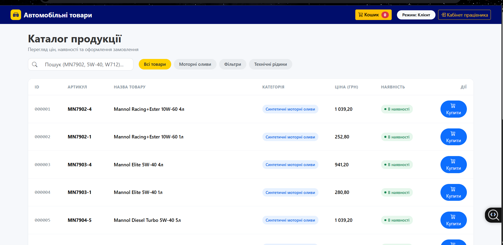
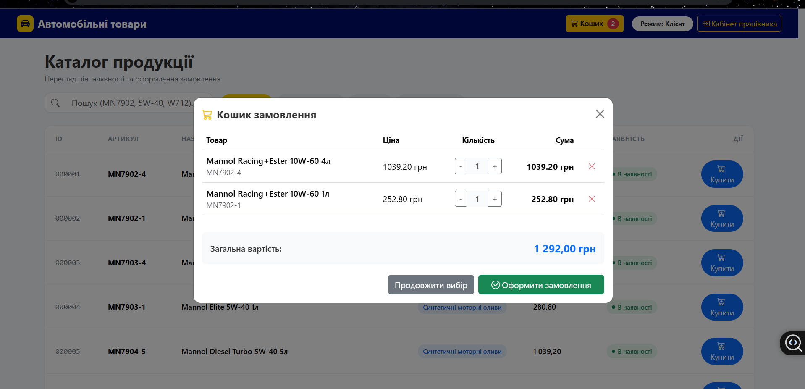
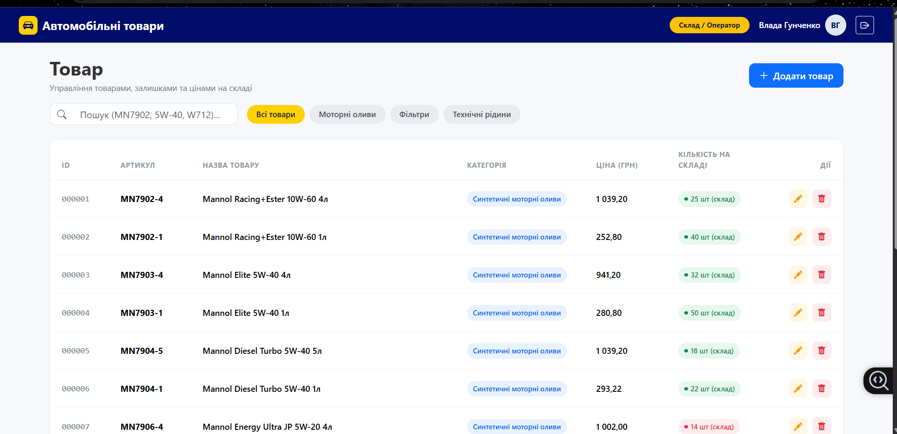
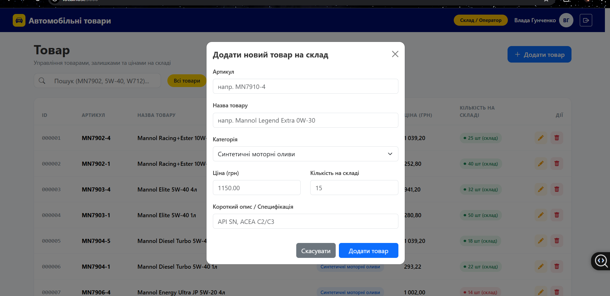

# Course_work
# Розробка застосунку для фірми з продажу автотоварів
### Автоматизована інформаційна система обліку автотоварів (АІС)

Курсовий проєкт з дисципліни «Проєктування автоматизованих інформаційних систем».  
Проєкт є базовим модулем складського обліку з перспективою масштабування у повнофункціональний веб-сервіс (дипломний проєкт).  
**Виконує:** студентка 45 групи Гунченко Владислава

---

## 📋 Управління проєктом
Відстеження етапів розробки та спринтів ведеться на внутрішній канбан-дошці:  
👉 [Канбан-дошка задач проєкту](тут_встав_посилання_на_свій_project)

---

## 📌 Основний функціонал

* **Клієнтський модуль (Каталог та замовлення):**
  * Перегляд актуальних залишків та цін продукції (мастильні матеріали, фільтри, технічні рідини).
  * Швидкий живий пошук та фільтрація за артикулом виробника, назвою та категорією.
  * Інтерактивний кошик покупця з можливістю регулювання кількості та підрахунком загальної вартості замовлення.

* **Модуль оператора складу (Панель управління):**
  * Авторизація персоналу складу через базу даних.
  * Відображення точної кількості одиниць продукції на складі в реальному часі.
  * Повний цикл CRUD-операцій:
    * Додавання нових товарних позицій через модальну форму.
    * Редагування цін та залишків на складі.
    * Списання та видалення застарілих або некоректних позицій.

---

## 🛠 Стек технологій
* **База даних:** PostgreSQL
* **Серверна частина:** Node.js, Express.js (REST API, CORS)
* **Клієнтська частина:** HTML5, CSS3 (Bootstrap 5.3, Bootstrap Icons), JavaScript (Fetch API)
* **Інструменти розробки та моделювання:** Visual Studio Code, pgAdmin / DBeaver, Figma, PlantUML

---

## 📸 Скріншоти інтерфейсу системи

### 1. Каталог продукції (Режим клієнта)


### 2. Кошик замовлення


### 3. Панель оператора складу


### 4. Додавання нового товару на склад


---

## 📂 Структура репозиторію
* `/database` — SQL-скрипти створення схеми даних та наповнення тестовими даними (`init.sql`).
* `/public` — клієнтська частина застосунку (HTML, стилі та інтерфейсна логіка).
* `/screenshots` — графічні матеріали демонстрації роботи системи.
* `server.js` — точка входу та REST API сервер на Express.js.
* `db.js` — модуль пулу з'єднань із базою даних PostgreSQL.

---

## 🚀 Інструкція із запуску проєкту локально

1. **Встановлення залежностей:**
   ```bash
   npm install